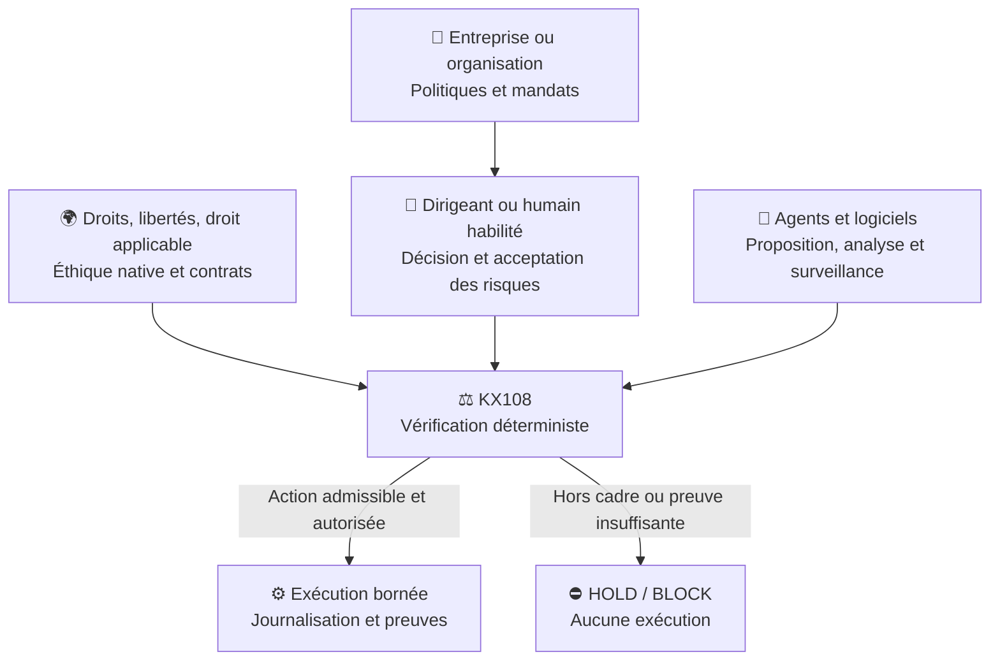
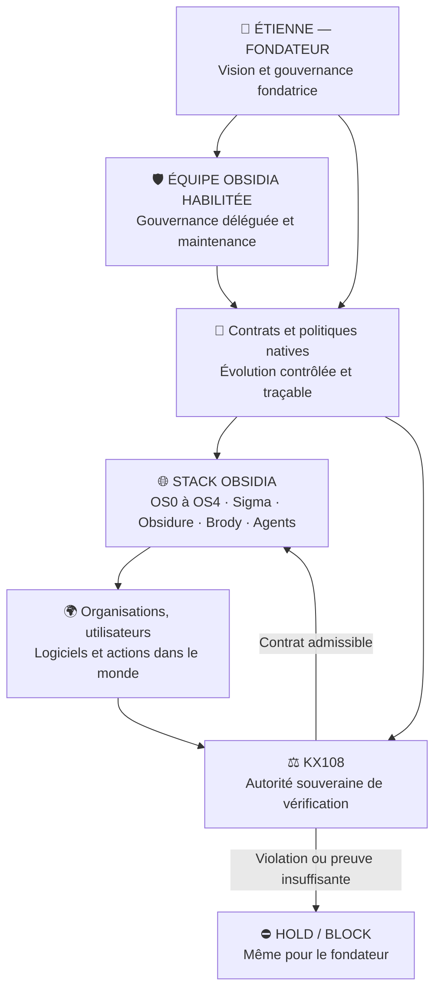

# **⚖️ OBSIDIA — DOCTRINE FONDATRICE DE GOUVERNANCE**

Proposition pour validation par Étienne · Version V1 · 28 novembre 2026

STATUT : EN ATTENTE DE VALIDATION

RELEASE = HOLD

## **La liberté de chacun s'arrête là où celle de l'autre commence.**

Cette phrase exprime le principe central du pouvoir dans Obsidia : chaque acteur possède des droits, des libertés et des responsabilités. Aucun acteur ne peut exercer son autorité au détriment des droits applicables aux autres.

Étienne, voici la doctrine réunifiée, en conservant tes mots et les distinctions que tu as apportées. Elle décrit **la gouvernance que tu veux construire**. Elle ne prétend pas que toutes ces garanties sont déjà implémentées.

## **1. Le principe fondateur : une liberté bornée**

Obsidia a pour objectif de permettre l'exploration, la création, la programmation et l'action dans le monde réel, tout en maintenant chaque opération dans un cadre explicite.

Ce cadre doit respecter :

- Les droits et les libertés de chacun.
- L'éthique native du projet.
- Les contrats applicables.
- Les politiques légitimes des entreprises et des organisations.
- Les obligations juridiques applicables.
- Les compétences et les responsabilités de chaque acteur.
- Les limites propres à chaque couche, chaque étage et chaque action dans le monde.

**Tout doit être borné. Tout doit pouvoir être joué, rejoué, vérifié et prouvé.**

Lorsqu'une action sort du cadre, Obsidia doit pouvoir dire **NON**.

Elle ne doit pas être obligée d'accepter une instruction parce qu'elle provient d'un humain, d'un dirigeant, d'une entreprise, d'un État, d'un administrateur, d'un fondateur ou d'un logiciel.

Une autorité ne remplace jamais une preuve.

Lorsqu'une action présente une contradiction, viole une borne applicable ou ne peut pas démontrer son admissibilité, elle doit être arrêtée.

```
ACTION ADMISSIBLE + AUTORITÉ VALIDE + PREUVES SUFFISANTES
    → AUTORISATION POSSIBLE

PREUVE MANQUANTE OU CONTRADICTION NON RÉSOLUE
    → HOLD

VIOLATION D'UNE INTERDICTION APPLICABLE
    → BLOCK

AUCUN BYPASS.
```

Le terme `HOLD` signifie que l'action est suspendue. `BLOCK` signifie qu'une interdiction a été établie. Les conditions exactes de ces verdicts doivent être définies dans les contrats de gouvernance.

# **2. Premier schéma — Gouvernance des entreprises, humains, logiciels et agents**

Ce premier schéma représente le fonctionnement d'Obsidia pour les organisations et les autres utilisateurs de la stack.

SCHÉMA A — Gouvernance opérationnelle




Les politiques, les droits et les décisions humaines alimentent le contrôle KX108. Aucun acteur ne peut s'autoriser lui-même à dépasser son mandat.

### **Le rôle de chaque acteur**

| Acteur                | Libertés et droits                                            | Limites                                                    |
| --------------------- | ------------------------------------------------------------- | ---------------------------------------------------------- |
| 🌍 Personnes et tiers | Droits, libertés, protections applicables                     | Leurs droits sont pris en compte selon le contexte         |
| 🏢 Entreprise         | Définir sa gouvernance interne, ses objectifs et ses contrats | Ne peut pas autoriser une violation des règles applicables |
| 👤 Dirigeant          | Choisir, décider et accepter des risques admissibles          | Ne peut pas imposer une opération hors de son autorité     |
| 👥 Employé            | Exercer les droits attachés à son poste et à son mandat       | Ne peut pas dépasser ses délégations                       |
| 🤖 Agent              | Explorer, proposer, calculer, vérifier, signaler              | Ne peut pas s'attribuer une autorité                       |
| 💻 Logiciel           | Exécuter les fonctions prévues par ses contrats               | Ne peut pas contourner les contrôles                       |
| ⚖️ KX108              | Vérifier et prononcer le verdict technique souverain          | Ne peut pas inventer des preuves ou des droits absents     |
| ⚙️ Exécuteur          | Exécuter l'action autorisée dans son périmètre exact          | Ne peut pas étendre une décision                           |

### **Le choix humain et le risque**

L'humain reste décideur dans le domaine où il possède légitimement l'autorité.

Obsidia peut lui présenter :

- Les conséquences possibles d'une action.
- Les risques identifiés.
- Les inconnues.
- Les contradictions.
- Les contrats concernés.
- Les droits d'autres acteurs pouvant être affectés.
- Les preuves disponibles et celles qui manquent.

Le dirigeant peut alors prendre une décision et accepter certains risques.

Mais **accepter un risque ne donne pas le droit de violer une borne applicable**.

Par exemple, une entreprise peut décider d'investir dans un projet risqué si elle dispose des compétences et autorisations nécessaires.

En revanche, le dirigeant ne peut pas demander à Obsidia de falsifier un rapport simplement parce qu'il accepte personnellement les conséquences.

Obsidia doit pouvoir lui répondre :

> « NON. Cette action sort du cadre autorisé. »

Le dirigeant peut apporter de nouvelles preuves ou demander une révision selon une procédure légitime. Il ne peut pas forcer l'exécution.

# **3. Deuxième schéma — Étienne et son équipe : gouvernance fondatrice de toute la stack**

C'est ici que se trouve ta distinction principale.

**Toi et ta future équipe n'avez pas la même autorité que les utilisateurs ordinaires, les entreprises clientes ou les agents.**

Pourquoi ?

Parce que vous êtes responsables de la construction, de la maintenance, de la sécurité et de l'évolution d'Obsidia.

Vous devez pouvoir créer de nouvelles couches, faire évoluer les contrats, réparer les erreurs, introduire des domaines et modifier l'architecture.

Mais cette autorité fondatrice ne constitue pas un bypass.

SCHÉMA B — Gouvernance fondatrice de la stack complète




Le fondateur et l'équipe peuvent faire évoluer les règles dans leurs compétences respectives. Leur autorité est particulière, mais les opérations demeurent soumises aux limites applicables et à la vérification souveraine.

### **👑 Étienne — Autorité fondatrice**

Tu possèdes un rôle différent parce que tu es le créateur et l'architecte du projet.

Ton autorité concerne notamment :

1. L'orientation fondamentale d'Obsidia.
2. La définition de son éthique native.
3. La conception des couches et des étages.
4. L'organisation de la gouvernance.
5. La définition des procédures d'évolution.
6. La création de nouveaux domaines.
7. L'attribution des responsabilités à ton équipe.
8. La proposition et la validation des évolutions relevant de tes compétences.
9. La supervision de la sécurité et de la cohérence globale.
10. La préservation de la doctrine fondatrice.

**Tu peux gouverner l'évolution du système. Tu ne peux pas contourner silencieusement ses interdictions.**

Si une règle est mauvaise, tu peux engager une procédure pour la corriger.

Tu ne peux pas simplement dire : « Je suis le fondateur, donc cette règle ne s'applique pas à moi. »

### **🛡️ L'équipe Obsidia — Autorité fondatrice déléguée**

Tes futurs collaborateurs pourront disposer de droits spécifiques selon leurs fonctions.

Par exemple :

| Fonction                   | Autorité possible                                                    |
| -------------------------- | -------------------------------------------------------------------- |
| Architecte système         | Proposer et maintenir l'architecture                                 |
| Responsable sécurité       | Auditer, signaler et appliquer les procédures de sécurité autorisées |
| Responsable gouvernance    | Gérer les contrats et les politiques selon son mandat                |
| Responsable infrastructure | Administrer les services et les environnements autorisés             |
| Responsable des agents     | Gérer les capacités, restrictions et contrats des agents             |
| Responsable conformité     | Examiner les contraintes juridiques et contractuelles applicables    |
| Auditeur indépendant       | Vérifier les preuves et signaler les contradictions                  |

Ces droits ne sont pas nécessairement identiques.

Ils doivent être explicites, bornés, révocables selon les contrats applicables et vérifiables.

Une personne chargée de la sécurité n'obtient pas automatiquement le droit de modifier les décisions souveraines.

Une personne chargée des modèles IA n'obtient pas automatiquement le droit de modifier les politiques d'une entreprise cliente.

Une personne chargée de l'infrastructure n'obtient pas automatiquement le droit de consulter toutes les données personnelles.

**Chaque rôle possède son propre cadre.**

# **4. Le principe non négociable : même le propriétaire peut être bloqué**

C'est un point que tu as répété depuis le début de la forge.

Tu veux que le système puisse te dire NON à toi aussi.

Et tu veux qu'il puisse faire la même chose avec ton équipe.

Voici comment je propose de le formaliser :

## **🔒 Principe de non-contournement fondateur**

La qualité de fondateur, propriétaire, administrateur ou membre de l'équipe Obsidia confère des responsabilités et des compétences particulières.

Elle ne confère aucun droit automatique de contourner les contrats, les interdictions ou les protections applicables.

Une évolution de politique doit être distincte d'une autorisation d'exécution.

Aucune modification de politique ne peut rétroactivement transformer une action interdite en action autorisée.

Lorsque l'action d'un membre de l'équipe, y compris le fondateur, sort du cadre ou manque de preuves, Obsidia doit pouvoir produire HOLD ou BLOCK.

Exemple :

Tu demandes à Obsidia de modifier une partie de son propre noyau.

Si tu possèdes l'autorité de proposer cette évolution, elle peut être préparée.

Mais la préparation ne vaut pas autorisation d'application.

Il faut encore vérifier les contrats de modification, les protections des chemins concernés, les preuves de compatibilité et les autorisations requises.

Si ces conditions ne sont pas satisfaites :

**HOLD. Même pour Étienne.**

Ce n'est pas une perte de ton autorité fondatrice.

C'est la conséquence de la gouvernance que tu as choisie.

# **5. L'éthique native : le droit de dire NON**

Tu veux qu'Obsidia puisse refuser une demande provenant :

- D'un particulier.
- D'une entreprise.
- D'un dirigeant.
- D'un État.
- D'une administration.
- D'un agent IA.
- D'un membre de l'équipe.
- De son propre fondateur.

Lorsque la demande viole une contrainte applicable.

Cette capacité doit fonctionner indépendamment du prestige, de la richesse, du statut ou de la puissance de l'acteur.

### **Trois situations à distinguer**

ADMISSIBLE

**Les preuves sont suffisantes et les autorités compétentes ont validé.**

L'action peut accéder à l'étage d'exécution dans son périmètre exact.

HOLD

**Une preuve manque, une contradiction subsiste ou une condition n'est pas satisfaite.**

L'exécution attend. Il faut résoudre le problème sans contourner les règles.

BLOCK

**Une interdiction applicable est établie.**

L'action est refusée. Une simple acceptation humaine du risque ne suffit pas à lever cette interdiction.

Il faudra toutefois définir précisément les principes de l'éthique native. Une règle trop vague pourrait permettre des refus arbitraires. L'objectif du déterminisme est justement de rendre les critères vérifiables, explicables et contestables selon une procédure définie.

# **6. Gouvernance des droits entre les étages**

Chaque étage doit disposer de droits distincts :

- **Voir** : quelles informations peut-il consulter ?
- **Proposer** : quelles actions peut-il suggérer ?
- **Décider** : sur quelles questions possède-t-il une compétence ?
- **Surveiller** : quelles opérations peut-il examiner ?
- **Bloquer** : quelles violations peut-il empêcher ?
- **Modifier** : quelles ressources peut-il changer ?
- **Exécuter** : quels effets peut-il produire dans le monde ?
- **Déléguer** : quels droits peut-il transmettre ?
- **Révoquer** : quelles autorisations peut-il retirer ?
- **Auditer** : quelles preuves peut-il vérifier ?

Ces droits ne doivent pas être confondus.

Par exemple, un agent qui possède le droit de surveiller une tâche ne possède pas nécessairement le droit de modifier cette tâche.

Un responsable qui peut autoriser une opération financière ne possède pas nécessairement le droit de modifier les journaux qui prouvent son exécution.

Un fondateur qui peut proposer une évolution des politiques ne possède pas automatiquement le droit de faire appliquer une version non validée.

**Le pouvoir est découpé en compétences explicites.**

# **7. La doctrine doit aussi protéger contre les abus de gouvernance**

Il faut intégrer une autre garantie découlant directement de ton principe de liberté.

Les règles d'une entreprise ne doivent pas permettre d'écraser les droits des personnes.

Mais l'éthique native d'Obsidia ne doit pas non plus devenir un prétexte pour exercer arbitrairement du pouvoir sur elles.

La gouvernance doit donc être :

- Explicite : les règles applicables sont identifiables.
- Justifiable : une décision possède des motifs.
- Vérifiable : les preuves sont consultables par les acteurs autorisés.
- Bornée : chaque contrôle possède un périmètre.
- Révisable : une politique peut évoluer selon une procédure légitime.
- Traçable : les changements et décisions peuvent être audités.
- Contestable : un acteur peut demander un examen lorsque ses droits le permettent.
- Non rétroactive par défaut : une nouvelle politique ne réécrit pas silencieusement les autorisations historiques.

Cela permet de protéger les libertés tout en conservant une gouvernance forte.

# **8. Formulation fondatrice proposée**

# **La doctrine de la liberté bornée — Obsidia**

Texte proposé pour validation fondatrice

> **« La liberté de chacun s'arrête là où celle de l'autre commence. »**
>
> Obsidia repose sur une gouvernance déterministe dont l'objectif est de permettre l'exploration, la création et l'action tout en garantissant le respect des droits, des libertés, des contrats, des politiques légitimes et de son éthique native.
>
> Chaque humain, agent, logiciel, organisation et étage du système possède un périmètre de droits et de responsabilités.
>
> L'humain reste décideur dans son domaine de compétence et peut accepter les risques relevant légitimement de son autorité. Cette liberté ne l'autorise pas à porter atteinte aux droits applicables aux autres.
>
> Le fondateur et l'équipe Obsidia possèdent une autorité de gouvernance particulière afin de construire, maintenir, administrer et faire évoluer la stack. Cette autorité est distincte de celle des autres utilisateurs et organisations.
>
> Cependant, aucun statut, y compris celui de fondateur ou de propriétaire, ne constitue un bypass.
>
> Obsidia possède le droit de dire NON lorsque l'action demandée sort du cadre, viole une borne applicable ou ne peut démontrer son admissibilité.
>
> KX108 demeure l'autorité souveraine de vérification des décisions d'exécution gouvernées. Il ne remplace pas les choix humains légitimes, mais garantit qu'une action ne s'exécute pas sans satisfaire les contrats, les compétences, les limites et les preuves requis.
>
> Toute action doit être bornée, traçable, vérifiable et rejouable dans les limites des preuves disponibles. Les contradictions non résolues et les preuves essentielles manquantes entraînent HOLD. Les violations établies entraînent BLOCK.
>
> Les politiques peuvent évoluer selon des procédures explicites, authentifiées et auditables. Leur évolution ne constitue jamais un contournement silencieux des protections en vigueur.
>
> **Le pouvoir n'est pas le droit de tout faire. Il est la capacité d'agir et de décider dans un périmètre légitime, sans détruire la liberté des autres.**

## **9. Ce que ta validation signifiera**

Si tu valides cette doctrine, nous pourrons préparer un document fondateur pour GitHub, par exemple :

`OBSIDIA_GOVERNANCE_FOUNDER_DOCTRINE_V1.md`

Il contiendra les deux schémas, la matrice des droits, les invariants et la distinction entre autorité fondatrice, autorité organisationnelle et autorité souveraine KX108.

**La validation du texte ne déclenchera aucune modification du code ni aucune activation de politique.** Son intégration documentaire sur GitHub sera une étape distincte.

**État actuel**

DOCTRINE : À VALIDER

KX108 : INCHANGÉ

GIT : AUCUNE MODIFICATION

RELEASE : HOLD

Étienne, voici donc les deux niveaux que tu voulais distinguer : **la gouvernance des acteurs qui utilisent Obsidia** et **ta gouvernance fondatrice, avec ton équipe, qui englobe l'évolution de l'ensemble de la stack**.

Dans les deux cas, la même règle demeure : **des droits différents, des responsabilités différentes, mais aucun bypass.** 🔒