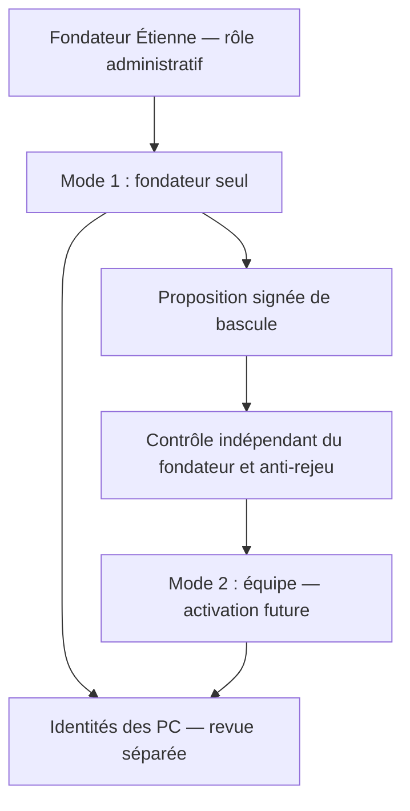

# Obsidia Gouvernance — G4N — un fondateur, équipe préparée

## Décision Étienne du 19 novembre 2026

**Mode de départ = 1 : fondateur seul.** Dès maintenant, préparer le mode 2
(équipe de plusieurs administrateurs), mais sa bascule doit dépendre d'une
**décision signée du fondateur**. Le fondateur administre uniquement
l'**enrôlement des identités des PC Obsidure**, jamais les décisions KX108.

Le mode 2 n'est pas activé par le simple fait qu'il est présent dans un
fichier Git, par une référence `responsible_refs` ou par la signature d'un
certificat issu du même plan public.

## Frontières et état actuel

| Élément | Actuellement | Condition future |
| --- | --- | --- |
| Fondateur `FOUNDER-ETIENNE` | Identifiant prévu, aucune clé admin réelle enrôlée | Identité personnelle séparée des PC, clé publique épinglée hors Git, revue indépendante |
| Mode 1 | `FOUNDER_ONLY` prévu dans le contrat | Admission réelle après ancrage administrateur indépendant |
| Mode 2 | `PREPARED`, zéro membre inventé | Membres authentifiés individuellement + décision fondateur vérifiée + anti-rejeu fiable |
| Portable `DESKTOP-Q5MD7J7` | Clé machine RSA existante, `ENROLLED_AWAITING_REVIEW` pour G4M | Approbation machine indépendante |
| Fixe `DESKTOP-SDOG0EL` | `PLANNED` — aucune clé générée ici | Enrôlement explicite depuis le fixe et revue indépendante |
| Autorité KX108 | **Seule autorité souveraine** | Inchangée, même avec l'équipe |
| RELEASE | `HOLD` | Nécessite les autres preuves G1/G2, C278 réel et autorisations souveraines |

## Contrat implémenté

- `OBSIDURE_ADMIN_BOOTSTRAP_PLAN_G4N_V1.json` est **public et non approuvé**.
- `obsidure_admin_bootstrap_g4n_v1.py` vérifie strictement la forme et
  l'absence d'escalade des rôles, l'unicité des identifiants et des empreintes,
  et le refus de réutiliser une clé PC comme clé administrateur.
- Une proposition `PROPOSE_ENABLE_TEAM_REVIEW` lie, sous un **domaine RSA
  distinct**, le plan entier, la liste de membres, l'empreinte publique du
  fondateur, un identifiant d'activation et un nonce.
- Le vérificateur accepte de signaler une **signature cryptographique valide
  d'une proposition synthétique**. Il renvoie toujours `status=HOLD`,
  `team_mode_activated=False`, `founder_trust_anchor_verified=False`.
- Ni création de clé réelle, ni signature avec la clé machine Windows, ni
  remplacement KX108, ni serveur, ni écriture métier.

## Tests Windows

Sur le **portable uniquement**, dans le worktree de convergence séparé,
exécuter la régression complète et les contrats G1/G2, puis
`tools/verify_g4n_admin_modes_windows_v1.ps1`. Cet outil ne génère qu'une
clé RSA éphémère **en mémoire** pour démontrer le futur protocole.

Les preuves à relever :

- `FOUNDER_ONLY_MODE_PREPARED=True`
- `TEAM_MODE_PREPARED=True`
- `SYNTHETIC_FOUNDER_SIGNED_SWITCH_PROPOSAL_VERIFIED=True`
- `FOUNDER_REAL_IDENTITY_ENROLLED=False`
- `TEAM_MODE_ACTIVATED=False`
- `KX108_AUTHORITY=UNCHANGED`
- `RELEASE=HOLD`

## Dépendances avant une activation réelle

1. Choisir et enrôler **séparément** la clé administrateur du fondateur,
   sans réutiliser la clé RSA de `DESKTOP-Q5MD7J7`.
2. Définir où réside la **racine de confiance protégée** et qui peut attester
   le fondateur. Un champ de plan ou un pin transmis par un appelant ne suffit pas.
3. Prévoir les identités réelles des membres, les révocations, la rotation
   des clés, la vérification des validations humaines, une protection
   persistante contre le rejeu et une procédure de récupération.
4. Ne brancher **aucune API d'activation** avant cette clôture. Séparer
   administration des machines et décisions souveraines KX108.
