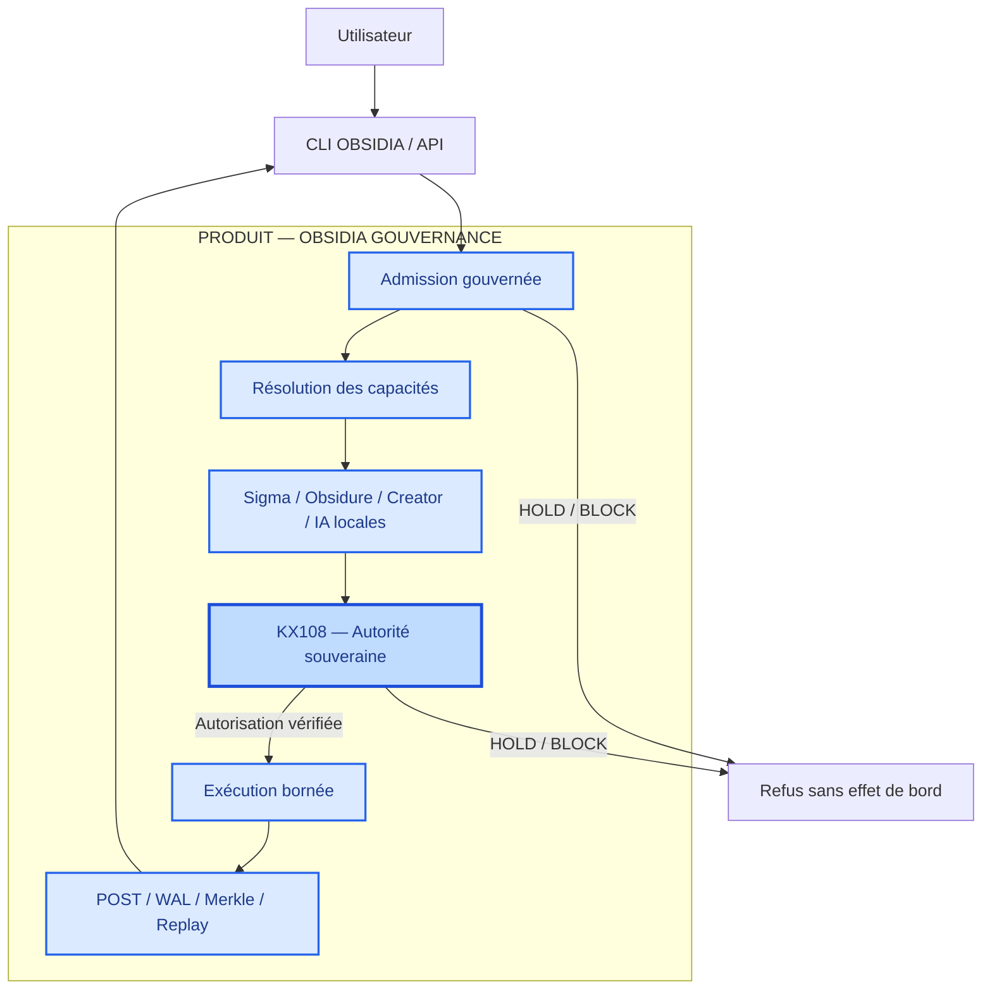
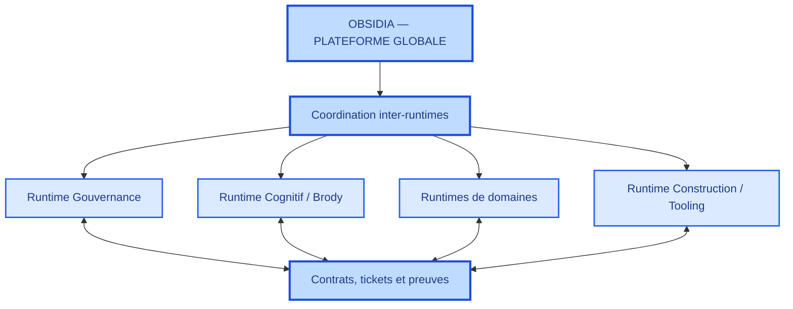
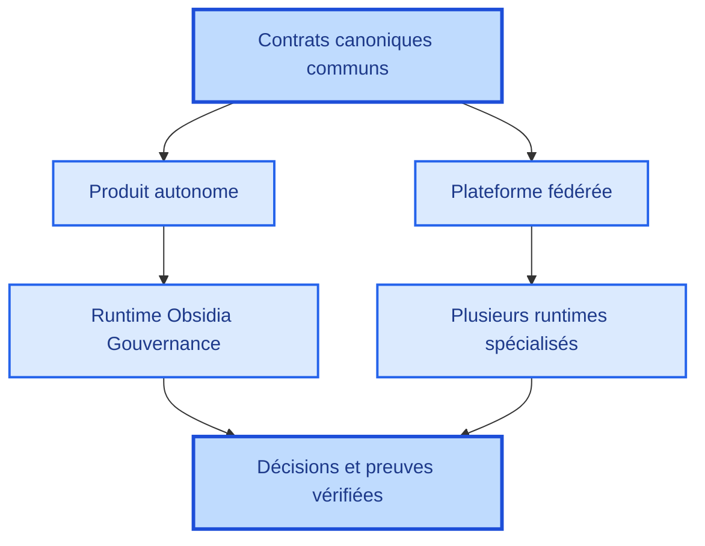
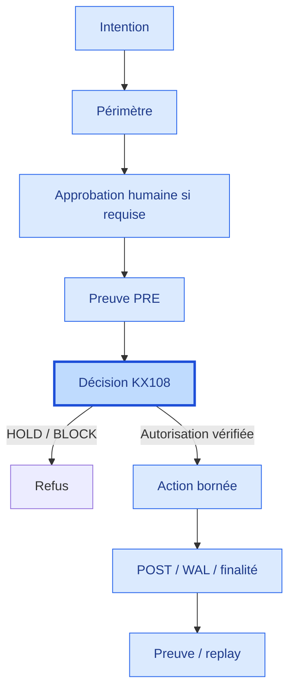

# OBSIDIA / X-108
## PLAN DIRECTEUR — CONVERGENCE, PREMIER PRODUIT ET ARCHITECTURE GLOBALE

**Révision V3 — 18 novembre 2026** · **Sources G1+G2 récupérées** · **Fusion fonctionnelle : HOLD**

**Décision architecturale : conserver et développer simultanément l'approche unifiée et l'approche distribuée.**

---

# I. LES TROIS NIVEAUX D'OBSIDIA

C'est la séparation essentielle qui manquait dans nos plans précédents.

| Niveau | Désignation | Description | Priorité |
|---|---|---|---|
| **NIVEAU 1 — PREMIER PRODUIT** | **Obsidia Gouvernance** | Un logiciel autonome, fondé sur un runtime logique unifié, intégrant les capacités nécessaires à la gouvernance des actions d'IA. | Priorité immédiate |
| **NIVEAU 2 — PLATEFORME OBSIDIA** | **Architecture multi-moteurs** | Plusieurs moteurs, runtimes et services spécialisés, capables de fonctionner indépendamment dans leurs périmètres et de coopérer sous des contrats gouvernés. | Construction parallèle |
| **NIVEAU 3 — VISION GLOBALE** | **Obsidia — OS cognitif** | L'architecture globale réunissant gouvernance, cognition, mémoire, agents, domaines, capacités, apprentissage, interfaces et systèmes distribués. | Long terme |

Ces trois niveaux sont complémentaires.

Le premier est destiné à devenir un produit démontrable et commercialisable.

Le deuxième prépare une plateforme capable de réunir plusieurs produits et systèmes.

Le troisième correspond à ta vision complète d'Obsidia.

**Nous n'avons pas besoin de terminer le troisième niveau pour commercialiser le premier.**

En revanche, le premier doit être conçu dès maintenant pour pouvoir évoluer vers les deux autres.

---

# II. LES DEUX APPROCHES ARCHITECTURALES À CONSERVER

Voici le tableau que nous avions opposé précédemment.

Cette fois, nous ne supprimons aucune colonne.

## 2.1 Tableau des deux architectures

| Architecture distribuée | Architecture unifiée |
|---|---|
| Plusieurs moteurs raccordés | Un moteur contenant plusieurs organes |
| Plusieurs runtimes à coordonner | Un runtime logique de référence |
| Communication entre systèmes | Communication interne entre fonctions |
| Chaque moteur possède son cycle de vie | Les organes partagent un cycle de vie gouverné |
| Plusieurs points d'entrée possibles | Entrée produit cohérente : CLI et API |
| Coordination inter-runtimes | Coordination interne |
| Adaptateurs et protocoles d'échange | Contrats internes communs |
| Gouvernance inter-systèmes | Gouvernance native du produit |
| Déploiements potentiellement distribués | Distribution logicielle cohérente |
| Vision plateforme Obsidia | Premier produit Obsidia Gouvernance |

**Décision : les deux architectures sont retenues.**

L'architecture unifiée sert de base au premier produit.

L'architecture distribuée sert de base à la plateforme globale.

## 2.2 Tableau des différences techniques

| Critère | Premier produit | Plateforme globale |
|---|---|---|
| Nom | Obsidia Gouvernance | Obsidia |
| Type | Logiciel de gouvernance | Plateforme distribuée |
| Runtime | Un runtime logique unifié | Plusieurs runtimes coordonnés |
| Moteurs | Fonctions internes spécialisées | Moteurs spécialisés interconnectés |
| Autorité | KX108 | Contrats KX108 applicables à chaque frontière |
| Exécution | Gouvernée localement | Gouvernée entre systèmes |
| Communication | Appels internes et adaptateurs | API, événements, tickets, protocoles |
| Déploiement | Produit autonome | Architecture multi-machines possible |
| Démonstration | Gouvernance de bout en bout | Coopération entre systèmes |
| Priorité | Produit présentable | Architecture extensible |

### Point fondamental

Dans l'architecture globale, avoir plusieurs runtimes ne signifie pas avoir plusieurs autorités capables de s'accorder des droits d'exécution.

Chaque runtime doit respecter les contrats souverains applicables.

Une demande provenant d'un autre moteur n'est pas automatiquement autorisée.

---

# III. SCHÉMA 1 — PREMIER PRODUIT : OBSIDIA GOUVERNANCE

**Architecture unifiée**



## 3.1 Ce que représente ce schéma

Un utilisateur lance Obsidia Gouvernance.

Le logiciel contient les capacités nécessaires à l'admission, l'évaluation, la construction, l'autorisation et la vérification d'actions.

Les composants peuvent être implémentés sous forme de modules ou utiliser certains processus externes, mais ils partagent un contrat de gouvernance commun.

Le modèle local peut être un service extérieur.

La gouvernance, elle, conserve son autorité propre.

### Règle du produit

**Une seule instance logique de gouvernance faisant autorité pour les opérations de ce runtime.**

Cela n'impose pas que chaque dépendance tourne dans le même processus système.

Cela impose une continuité des contrats, des décisions et des preuves.

---

# IV. SCHÉMA 2 — PLATEFORME GLOBALE OBSIDIA

**Architecture distribuée**

C'est ici que nous conservons l'autre approche.



Ce schéma représente une architecture cible future, pas des runtimes déjà déployés.

## 4.1 Capacités envisagées

La plateforme pourrait faire coopérer :

- Obsidia Gouvernance.
- Les fonctions cognitives de Brody.
- Les mécanismes de mémoire.
- Les agents spécialisés.
- Les outils de construction.
- Les domaines métiers.
- Les interfaces externes.
- Les infrastructures réparties entre plusieurs machines.

Les domaines GPS, communication et aviation pourront conserver leur cohérence fonctionnelle.

Les fonctions liées à d'autres domaines, comme le trading, restent soumises à leurs contrats spécifiques.

## 4.2 Ce qu'il faut éviter

Nous ne devons pas reconstruire l'intégralité du moteur de gouvernance dans chaque service.

Nous devons définir des contrats qui permettent aux runtimes :

1. De déclarer leurs capacités.
2. De formuler une intention.
3. De présenter leurs preuves.
4. De demander une décision applicable.
5. De vérifier les autorisations reçues.
6. D'exécuter uniquement les opérations autorisées.
7. De retourner leurs preuves POST.

La coordination globale ne doit pas devenir un raccourci permettant de contourner les contrôles locaux.

---

# V. COMMENT LES DEUX ARCHITECTURES COEXISTENT

C'est le point technique le plus important de cette révision.

Un même composant peut être exploité de deux manières.

## 5.1 Fonction interne ou service indépendant

| Composant | Mode produit unifié | Mode plateforme distribuée |
|---|---|---|
| KX108 | Autorité du runtime Gouvernance | Contrats de décision vérifiables entre runtimes |
| Sigma | Organe d'évaluation interne | Évaluateur accessible par contrat |
| Obsidure | Organe de construction interne | Service spécialisé de construction |
| Creator | Fonction interne de création | Capacité disponible depuis plusieurs interfaces |
| Mémoire | Contexte du runtime | Mémoire exposée selon les permissions |
| IA locales | Providers de propositions | Providers accessibles à différents moteurs |
| Ragnarok | Adaptateur HTTP gouverné | Passerelle de communication entre systèmes |
| Domaines | Capacités appelables | Runtimes spécialisés |

### Décision

**Nous devons préserver les contrats fonctionnels pour permettre les deux formes d'utilisation.**

Mais cela ne signifie pas dupliquer le code.

L'objectif est de réutiliser les mêmes fonctions de référence, avec des adaptateurs adaptés à leur contexte.

## 5.2 Schéma de coexistence



### Ce que cela implique pour notre travail

Nous construisons :

- Les contrats internes du runtime unique.
- Les contrats d'interopérabilité nécessaires à la plateforme.
- Les adaptateurs permettant de passer d'un fonctionnement à l'autre.

**Le premier produit ne doit pas dépendre d'une fédération complète pour fonctionner.**

Et la plateforme future ne doit pas obliger à réécrire toute sa gouvernance.

---

# VI. REGISTRE PERMANENT DES DEUX PC

Nous conservons exactement les identités confirmées.

| | PC PORTABLE | PC FIXE |
|---|---|---|
| Nom Windows | `DESKTOP-Q5MD7J7` | `DESKTOP-SDOG0EL` |
| Compte | `User` | `Aubin` |
| Chemin utilisateur | `C:\Users\User` | `C:\Users\Aubin` |
| Rôle actuel | Intégration | Sources complémentaires |
| Chantier K1 | Présent | Pas la référence actuelle |
| 4A1 / X108-CREATE / V01 C1 | Variantes récupérées | Sources originales |
| GitHub | Dépôt récupéré | Sources publiées |

### Portable

```text
C:\Users\User\.codex\visualizations\2026\11\kx108_zero_vote_guard_fix

C:\Users\User\obsidia-convergence
```

### Fixe

```text
C:\Users\Aubin\Desktop\obsidia-4a1-pc-v2-write-closure-v1

C:\Users\Aubin\Desktop\obsidia-x108-create-pre-v1

C:\Users\Aubin\Desktop\obsidia-x108-create-integration-v1

C:\Users\Aubin\Desktop\OBSIDIA_WORLDS\obsidia-v01-c1
```

### Règle permanente

Le terme `FIX` désigne un chantier Git.

Le **PC fixe** désigne `DESKTOP-SDOG0EL`.

Aucune opération ne doit mélanger les chemins des deux machines.

Le futur fichier `docs/MACHINES.md` contiendra ce registre.

---

# VII. ÉTAT DES SOURCES ET PREUVES

## 7.1 Dépôt de convergence

[Eaubin08/obsidia-convergence](https://github.com/Eaubin08/obsidia-convergence)

Branche :

`integration/g1-g2`

Commit distant vérifié :

`823c9d42ae157e4a830f183022fb77649148798e`

| Source | Statut |
|---|---|
| K1 Zero Vote Guard | **IMPORTÉ** |
| 4A1 Write Closure | **IMPORTÉ** |
| X108-CREATE PRE / Integration | **IMPORTÉ** |
| V01 C1 WORLD_ACTION | **IMPORTÉ** |
| **Fusion fonctionnelle G1+G2** | **HOLD** |

## 7.2 Résultat du transfert

| Source | Fichiers de moteurs | Fichiers de tests |
|---|---:|---:|
| 4A1 Write Closure | 4 | 40 |
| X108-CREATE PRE | 1 | 42 |
| X108-CREATE Integration | 1 | 50 |
| V01 C1 WORLD_ACTION | 2 | 82 |
| **Total** | **8** | **214** |

Les tests ont été transférés, mais ils n'ont pas encore été exécutés ensemble dans une base unifiée.

L'import K1 est un snapshot ciblé des fichiers modifiés et non suivis. Il ne constitue pas à lui seul une installation exécutable complète.

### Sources

- [Manifeste K1](https://github.com/Eaubin08/obsidia-convergence/blob/integration/g1-g2/imports/k1-zero-vote-guard/IMPORT_MANIFEST.json)
- [Manifeste du PC fixe](https://github.com/Eaubin08/obsidia-convergence/blob/integration/g1-g2/imports/pc2-governance-g1-g2/IMPORT_MANIFEST.json)
- [Commit du transfert](https://github.com/Eaubin08/obsidia-convergence/commit/823c9d42ae157e4a830f183022fb77649148798e)

---

# VIII. LES SIX CHANTIERS DU PREMIER PRODUIT

Nous conservons G1 à G6.

Mais chaque chantier possède désormais deux lectures :

- Sa contribution au produit Obsidia Gouvernance.
- Son contrat de réutilisation dans la plateforme globale.

| Chantier | Premier produit | Architecture globale |
|---|---|---|
| **G1 — KX108** | Autorité du runtime unique | Contrat souverain inter-runtimes |
| **G2 — CREATE / Write Closure** | Contrôle interne des mutations | Mutations gouvernées sur services distants |
| **G3 — Sigma** | Évaluation interne | Évaluations distribuées |
| **G4 — Obsidure** | Construction native | Service de construction spécialisé |
| **G5 — CLI / Creator / IA locales** | Interface et capacités produit | Interfaces et capacités accessibles aux autres runtimes |
| **G6 — Ragnarok** | Accès API gouverné | Transport et coordination entre runtimes |

---

# IX. G1 — NOYAU KX108 ET CONTRATS SOUVERAINS

**P0**

## Objectif produit

Conserver une seule autorité souveraine dans Obsidia Gouvernance.

## Objectif plateforme

Définir les contrats permettant à plusieurs runtimes de demander, transporter et vérifier des décisions, sans créer d'autorités concurrentes.

## Sources

| Origine | Fichier | Fonction |
|---|---|---|
| Portable K1 | `obsidia_kx108_decision_store.py` | HMAC et revalidation PRE |
| Portable K1 | `obsidia_governed_execution_driver_v0.py` | Exécution gouvernée |
| Portable K1 | `sovereign_ticket.py` | Tickets |
| Portable K1 | `ticket_store.py` | Persistance |
| Fixe V01 C1 | `obsidia_kx108_decision_store.py` | WORLD_ACTION |
| Fixe V01 C1 | `obsidia_governed_runtime_cycle_v1.py` | Cycle gouverné et domaines |

## Protections à préserver

- HMAC.
- PRE canonique.
- Tickets.
- Nonces.
- Anti-rejeu.
- Identité de décision.
- Identité d'action.
- Zéro vote : aucun ACT implicite.
- Refus des preuves insuffisantes.
- Non-souveraineté des périphéries.

## Décision P0

Le Decision Store V01 C1 apporte `WORLD_ACTION_PRE_EXECUTION`.

Mais la comparaison précédente indique qu'il ne possède pas toutes les protections K1 renforcées.

**Il doit être intégré comme extension, jamais comme remplacement intégral du Decision Store K1.**

## Travaux communs aux deux architectures

1. Identifier les signatures PRE.
2. Comparer les appelants.
3. Définir un contrat souverain de référence.
4. Préserver HMAC et vérification canonique.
5. Intégrer WORLD_ACTION.
6. Définir la représentation vérifiable d'une décision entre runtimes.
7. Tester les refus et les incompatibilités.
8. Vérifier qu'aucun moteur distant ne peut produire seul un ACT.

### Point ouvert

Le verdict K1 publié indique encore une limite TOCTOU/handle stable.

Des travaux locaux plus récents peuvent avoir évolué : ils devront être vérifiés avant de retenir la version canonique.

### Livrables G1

**Produit :** autorité KX108 intégrée.

**Plateforme :** contrat de décision inter-runtimes documenté et vérifiable.

---

# X. G2 — CREATE, GLOBAL WRITE CLOSURE ET MERKLE

**P0**

## Objectif produit

Fermer les voies de mutation du runtime Gouvernance.

## Objectif plateforme

Préparer des opérations gouvernées entre plusieurs runtimes, sans donner aux messages distants valeur d'autorisation automatique.

## Sources

| Source | Fonction |
|---|---|
| Portable K1 / CREATE | Protection des chemins et cible absente |
| Fixe 4A1 | Global Write Closure |
| Fixe X108-CREATE PRE | Adaptateur de preuve PRE |
| Fixe X108-CREATE Integration | Raccordements |
| Fixe V01 C1 | WORLD_ACTION |
| Fixe 4A1 Merkle | Calcul non mutant |

## Cycle commun



## Travaux G2

### G2.1 — WRITE

Empêcher toute écriture non gouvernée dans le périmètre contrôlé.

### G2.2 — CREATE

Préserver `CREATE_TARGET_FROM_SOURCE`.

Vérifier :

- Cible initialement absente.
- Chemin autorisé.
- Identité de la source.
- Identité de la cible.
- Protection TOCTOU.
- Autorisation correspondant à l'opération exacte.

### G2.3 — WAL

Préserver :

- Préparation.
- Finalisation.
- Recovery.
- Rollback.
- Replay.
- Protection contre les fausses réussites.

### G2.4 — MERKLE

Le calcul du scellement reste distinct de sa publication.

Aucune réécriture automatique non autorisée.

### G2.5 — CONTRAT DISTRIBUÉ

Pour l'architecture globale, préparer le transport vérifiable :

- De l'intention.
- De l'identité de l'action.
- De la décision.
- Du ticket applicable.
- Des preuves PRE.
- Du résultat POST.

Une autorisation concernant un runtime ou une ressource ne doit pas être réutilisable librement dans un autre contexte.

## Tests G2

| Situation | Résultat attendu |
|---|---|
| CREATE sans PRE | Refus |
| Cible déjà existante | Refus si création attendue |
| Chemin détourné | Refus |
| Ticket invalide | Refus |
| Ticket rejoué | Refus |
| Modification concurrente | Refus sûr |
| Échec WAL | Aucune fausse finalité |
| Scellement automatique interdit | Pas d'écriture |
| POST incompatible | Refus de clôture |
| Autorisation provenant d'un autre runtime | Vérification du périmètre et de la légitimité |

### Livrables G2

**Produit :** mutations internes gouvernées.

**Plateforme :** contrat d'opération inter-runtimes défini et testé sur un périmètre isolé.

---

# XI. G3 — SIGMA

**Évaluation**

## Objectif produit

Sigma devient l'organe d'évaluation du runtime Gouvernance.

## Objectif plateforme

Sigma peut également fournir des évaluations à d'autres runtimes par des contrats explicites.

## Sources retenues

- `sigma/guard.py`
- `sigma/contracts.py`
- Contrats d'évaluation.
- Champs inconnus.
- Ancrages d'état.
- Tests zéro vote.

La variante 4A1 contient notamment :

`physical_state_anchor`

`state_anchor_kind`

## Invariants

- Sigma évalue.
- KX108 décide.
- Une évaluation positive ne constitue pas une autorisation.
- Zéro vote n'accorde pas ACT.
- Les champs inconnus ne sont pas ignorés permissivement.

### Livrables

**Produit :** organe Sigma intégré.

**Plateforme :** interface d'évaluation réutilisable entre runtimes.

---

# XII. G4 — OBSIDURE

**Construction**

## Objectif produit

Obsidure devient la fonction native de construction et de préparation gouvernée.

## Objectif plateforme

Obsidure peut également fournir une capacité de construction à d'autres runtimes, sous leurs contrats applicables.

## Sources à sélectionner

- Obsidure F7.
- R10.
- R12.
- Modes supervisés.
- Pipeline `TOOLING_BUILD`.
- Adaptateurs de mission.
- Mécanismes de vérification indépendante.

## Fonctions

1. Recevoir une intention admise.
2. Résoudre les capacités existantes.
3. Préparer une construction.
4. Produire une proposition.
5. Demander les autorisations nécessaires.
6. Préparer une exécution bornée.
7. Retourner les preuves.

## Protections

- Aucun APPLY direct autonome.
- Aucun faux ALLOW.
- Aucun dépassement de périmètre.
- Aucune activation automatique.
- Aucun résultat simulé déclaré comme action réelle.

### Livrables

**Produit :** Obsidure intégré comme organe de construction.

**Plateforme :** service de construction gouverné pouvant être sollicité par d'autres systèmes.

---

# XIII. G5 — CLI, CREATOR MODE, IA LOCALES ET MÉMOIRE

**Interface du produit**

## Objectif produit

Permettre de piloter Obsidia Gouvernance depuis la CLI existante.

## Objectif plateforme

Permettre à d'autres interfaces et runtimes d'utiliser les capacités autorisées sans reconstruire la gouvernance.

## Sources

- `scripts/obsidia.ps1`
- `scripts/obsidia_cli.py`
- Dispatch CLI.
- Routeurs existants.
- Mémoire native.
- Contrats Creator.
- Providers locaux.
- Adaptateurs API.

## Creator Mode

Le contrat importé prévoit :

```text
creator plan
creator build
creator status
creator inspect
```

Source :

[CREATOR_MODE_V0_TASK.md](https://github.com/Eaubin08/obsidia-convergence/blob/integration/g1-g2/imports/k1-zero-vote-guard/CREATOR_MODE_V0_TASK.md)

## Fonctionnement produit

1. Admission de la demande.
2. Résolution des capacités.
3. Sélection des fonctions nécessaires.
4. Invocation éventuelle des IA locales.
5. Proposition.
6. Vérification souveraine.
7. Exécution bornée.
8. POST et preuves.

## Fonctionnement global

La plateforme doit pouvoir solliciter les mêmes capacités par des interfaces gouvernées.

Mais les appels distants ne doivent pas pouvoir contourner l'admission ou les contrôles applicables.

## IA locales

Nous conservons l'utilisation des providers existants.

Notamment Ollama lorsqu'il est présent et compatible.

Aucun modèle n'est supposé disponible sans inventaire.

Aucune installation automatique.

## Mémoire

La mémoire doit conserver son rôle de contexte et de provenance.

Une information mémorisée ne devient pas une autorisation.

### Livrables

**Produit :** CLI unique donnant accès au runtime Gouvernance.

**Plateforme :** interfaces communes permettant aux autres runtimes de solliciter ses capacités.

---

# XIV. G6 — RAGNAROK ET COMMUNICATION

**HOLD**

## Objectif produit

Exposer les fonctions nécessaires du runtime Gouvernance par une interface HTTP contrôlée.

## Objectif plateforme

Préparer une passerelle de communication entre plusieurs runtimes Obsidia.

## Source identifiée

```text
runtime_terrain_bank_trading_gps/server.kernel.sealed.cjs
```

Port historique :

`3001`

Les audits ont identifié un mécanisme périodique d'auto-scellement.

## Travaux

1. Identifier les routes.
2. Identifier les consommateurs.
3. Vérifier authentification et permissions.
4. Isoler les requêtes.
5. Préserver les frontières KX108.
6. Éviter les écritures automatiques non gouvernées.
7. Vérifier Merkle.
8. Tester les interruptions.
9. Tester la concurrence.
10. Tester les appels entre runtimes.

### Livrables

**Produit :** API gouvernée.

**Plateforme :** mécanisme de transport et de coordination compatible avec les contrats souverains.

---

# XV. CONSTRUCTION SIMULTANÉE DES DEUX APPROCHES

Tu veux faire les deux en même temps.

Je retiens cette décision.

Mais je distingue les travaux nécessaires au premier produit de ceux qui préparent l'architecture globale.

Cela évite qu'un chantier futur bloque inutilement le logiciel présentable.

## Deux axes parallèles

| **AXE A — Produit Gouvernance** | **AXE B — Plateforme Obsidia** |
|---|---|
| Runtime unifié | Multi-runtimes |
| Contrats internes | Contrats inter-systèmes |
| Exécution locale | Transport des décisions |
| CLI native | Adaptateurs |
| Preuves produit | Coordination |
| Démonstration investisseur | Démonstration distribuée |

> **SOCLE COMMUN : KX108 — Contrats — Tickets — PRE/POST — Preuves**  
> Une référence de gouvernance, réutilisable dans les deux architectures.

## Matrice d'avancement simultané

| Étape | Axe A — Produit unifié | Axe B — Plateforme distribuée |
|---|---|---|
| G1 | Contrat souverain interne | Contrat de décision inter-runtimes |
| G2 | Mutation locale gouvernée | Contrat de mutation distante |
| G3 | Sigma interne | Interface d'évaluation distribuée |
| G4 | Obsidure interne | Interface de construction distante |
| G5 | CLI / Creator / IA | Interfaces de capacités |
| G6 | API du produit | Transport inter-runtimes |
| Validation | Démonstration locale complète | Démonstration de coopération entre runtimes |

### Règle

Les contrats des deux axes sont conçus ensemble.

Leurs preuves d'exécution restent distinctes.

Un PASS du produit local ne prouve pas automatiquement que la coordination distribuée est sécurisée.

Inversement, une interface de fédération non terminée ne doit pas empêcher la clôture du premier produit si elle n'appartient pas à son périmètre requis.

---

# XVI. PREMIER PRODUIT — OBJECTIF INVESTISSEURS

C'est ici que nous devons rester très concrets.

**Obsidia Gouvernance doit devenir un véritable logiciel que tu peux démontrer.**

Pas uniquement un ensemble de tests.

Pas uniquement une architecture théorique.

Pas uniquement une documentation.

## Démonstration 1 — Refus souverain

Une IA propose une action non autorisée.

Résultat attendu :

- KX108 refuse.
- Aucune action réelle.
- Preuve du refus.

## Démonstration 2 — Action gouvernée

Une IA propose une action admissible.

Résultat attendu :

- Contrôles PRE.
- Décision souveraine.
- Exécution bornée.
- Vérification POST.
- Preuve auditable.

## Démonstration 3 — Tentative de contournement

Un agent tente d'exécuter une opération sans décision applicable.

Résultat attendu :

- Refus.
- Aucun effet de bord.
- Trace du contournement.

## Démonstration 4 — Construction

Creator et Obsidure préparent une capacité.

Résultat attendu :

- Proposition.
- Contrôle de la construction.
- Autorisation adaptée.
- Preuves de résultat.
- Absence d'activation autonome.

## Démonstration 5 — Replay

Le logiciel retrouve :

- Intention.
- Décision.
- Ticket.
- Action.
- Empreintes.
- Résultat POST.

### Positionnement du produit

> Obsidia Gouvernance est un logiciel de gouvernance des actions d'intelligence artificielle.
>
> Il sépare structurellement la capacité de proposer une action du droit de l'exécuter.
>
> Son runtime unifié permet de contrôler les intentions, les permissions, les décisions, les exécutions et leurs preuves.
>
> Il peut fonctionner comme produit autonome et s'intégrer à des architectures plus larges par des contrats gouvernés.

---

# XVII. VISION PRODUIT — PLATEFORME OBSIDIA

À l'échelle suivante, tu ne présentes plus uniquement le runtime Gouvernance.

Tu disposes progressivement d'une famille de capacités et de produits interopérables.

| Domaine | Fonction dans la plateforme |
|---|---|
| Gouvernance | Autorité et vérification |
| Cognition / Brody | Compréhension et interaction |
| Sigma | Évaluation et cohérence |
| Obsidure | Construction et adaptation |
| Mémoire | Contexte et provenance |
| Creator | Création de capacités |
| Domaines spécialisés | Interprétation et actions métier |
| Runtime distribué | Coordination entre systèmes |
| Interfaces | CLI, API et autres surfaces |

La gouvernance peut devenir l'un des produits fondateurs de cette plateforme.

Elle ne doit toutefois pas absorber artificiellement tous les autres domaines.

Une fonction cognitive ou un moteur métier peut disposer de son propre runtime, tout en respectant les frontières de gouvernance.

---

# XVIII. VISION GLOBALE — OBSIDIA OS COGNITIF

Nous conservons ta vision complète.

Elle dépasse le premier produit.

Elle comprend notamment les différentes couches OS déjà définies :

| Couche | Fonction structurelle |
|---|---|
| OS0 | Moteur et fondations |
| OS1 | Fonctions cognitives |
| OS2 | Interfaces et capacités MCP |
| OS3 | Reverse et mécanismes associés |
| OS4 | Traduction et adaptation |

Ces appellations sont conservées comme repères de ton architecture existante.

La convergence actuelle ne démontre pas encore leur intégration globale.

## Vision long terme

Obsidia doit pouvoir :

- Recevoir des demandes.
- Comprendre et structurer des intentions.
- Résoudre les capacités disponibles.
- Mobiliser des fonctions spécialisées.
- Construire de nouvelles capacités.
- Gouverner les actions.
- Conserver leurs preuves.
- Maintenir des mémoires structurées.
- Coordonner plusieurs systèmes.
- Fonctionner sur différentes infrastructures.

**Le premier produit constitue une réalisation concrète d'une partie de cette vision, pas une réduction définitive d'Obsidia à la gouvernance.**

---

# XIX. INVARIANTS COMMUNS AUX DEUX ARCHITECTURES

Les règles fondamentales sont conservées.

| Invariant | Produit unifié | Plateforme distribuée |
|---|---|---|
| KX108 conserve l'autorité applicable | Obligatoire | Obligatoire |
| Aucun agent ne s'auto-autorise | Obligatoire | Obligatoire |
| Absence de preuve → HOLD | Obligatoire | Obligatoire |
| Tickets vérifiés | Obligatoire | Obligatoire |
| PRE avant action | Obligatoire | Obligatoire |
| POST après exécution | Obligatoire | Obligatoire |
| Anti-rejeu | Obligatoire | Obligatoire |
| Traçabilité | Obligatoire | Obligatoire |
| Préservation des protections K1 | Obligatoire | Obligatoire |
| Contrôle des frontières entre runtimes | Non requis pour le fonctionnement local autonome | Obligatoire |
| Isolation des requêtes | Selon les interfaces du produit | Obligatoire |
| Refus des autorisations hors périmètre | Obligatoire | Obligatoire |

Aucun raccordement distant ne doit permettre de contourner une protection qui serait obligatoire dans le runtime local.

---

# XX. SOURCES EXACTES DES DÉCISIONS

Nous conservons la provenance documentaire du plan.

| Constat | Source | Décision |
|---|---|---|
| Deux PC avec sources différentes | Audits inter-PC | Préserver les provenances |
| 61 variantes portable / 32 fixe | Rapport des sources | Comparaison ciblée |
| 22 chemins de composants | Matrice inter-PC | Ne pas recopier tous les dépôts |
| HMAC renforcé dans K1 | Decision Store K1 | Référence sécuritaire |
| WORLD_ACTION présent dans V01 C1 | Decision Store V01 C1 | Extension distincte |
| CREATE divergent | Adaptateurs PRE | Réconciliation |
| Write Closure 4A1 | `obsidia_build.py` | Fermeture des mutations |
| Merkle non mutant 4A1 | `audit_merkle.py` | Calcul séparé de publication |
| Sigma Contracts divergents | `sigma/contracts.py` | Contrats communs |
| Obsidure supervisé | Sources F7/R10/R12 | Pas d'APPLY direct |
| Creator prévu | `CREATOR_MODE_V0_TASK.md` | Intégration native |
| Ragnarok auto-scellement | Audit Node | Contrôle des écritures |

### Références GitHub

- [Plan G1→G6 existant](https://github.com/Eaubin08/obsidia-convergence/blob/integration/g1-g2/docs/PLAN_CONVERGENCE.md)
- [Inventaire des sources](https://github.com/Eaubin08/obsidia-convergence/blob/integration/g1-g2/docs/SOURCES_A_IMPORTER.md)
- [Tests obligatoires G1+G2](https://github.com/Eaubin08/obsidia-convergence/blob/integration/g1-g2/docs/GATES_G1_G2.md)
- [Sources K1](https://github.com/Eaubin08/obsidia-convergence/tree/integration/g1-g2/imports/k1-zero-vote-guard)
- [Sources PC fixe](https://github.com/Eaubin08/obsidia-convergence/tree/integration/g1-g2/imports/pc2-governance-g1-g2)
- [Contrat Creator V0](https://github.com/Eaubin08/obsidia-convergence/blob/integration/g1-g2/imports/k1-zero-vote-guard/CREATOR_MODE_V0_TASK.md)
- [Verdict K1 publié](https://github.com/Eaubin08/obsidia-convergence/blob/integration/g1-g2/imports/k1-zero-vote-guard/K1_FINAL_CLOSURE/K1_FINAL_VERDICT.json)

### Archives d'audit

Nous conservons également comme références :

- `RAPPORT_CONVERGENCE_SOURCES_INTERPC.md`
- `MATRICE_22_CONTRATS_INTERPC.csv`
- `ABI_KX108_PRE_COMPATIBILITE.csv`
- `PROVENANCE_93_SOURCES.csv`

---

# XXI. REGISTRE DES POINTS OUVERTS

| ID | Sujet | Produit | Plateforme |
|---|---|---|---|
| G1-01 | Contrat PRE commun | HOLD | Contrat partagé à définir |
| G1-02 | HMAC K1 / WORLD_ACTION | HOLD | Vérification distante à définir |
| G1-03 | Zero Vote | HOLD | Refus inter-runtimes à tester |
| G2-01 | CREATE | HOLD | Contrat distant à définir |
| G2-02 | Write Closure | HOLD | Frontière distante à tester |
| G2-03 | TOCTOU | HOLD | Même garantie à préserver |
| G2-04 | WAL / finalité | HOLD | Corrélation inter-runtimes à définir |
| G2-05 | Merkle | HOLD | Preuves transportables à examiner |
| G3-01 | Sigma | En attente | Interface distribuée à définir |
| G4-01 | Obsidure | En attente | Service spécialisé à définir |
| G5-01 | CLI | En attente | Interfaces multiples à préparer |
| G5-02 | Creator | En attente | Capacité distante à préparer |
| G5-03 | IA locales | En attente | Providers distribués à examiner |
| G6-01 | Ragnarok | HOLD | Transport inter-runtimes à sécuriser |

---

# XXII. ORGANISATION DES BUILDS

Les deux architectures sont travaillées dans le même programme.

## Build A — Runtime Gouvernance

Livrables :

- KX108 unifié.
- CREATE gouverné.
- Write Closure.
- Sigma intégré.
- Obsidure intégré.
- Creator.
- CLI.
- Preuves et replay.
- Distribution logicielle cohérente.

## Build B — Fédération Obsidia

Livrables :

- Contrats inter-runtimes.
- Identités et périmètres.
- Tickets transportables et vérifiables selon le contrat.
- Raccordements d'évaluation.
- Raccordements de construction.
- Communication gouvernée.
- Preuves inter-runtimes.
- Tests de non-contournement.

### Ordre de travail

Nous commençons toujours par G1+G2, car les deux architectures dépendent de ces garanties.

Mais dès G1, nous examinons simultanément :

- Le contrat interne.
- Son futur usage inter-runtimes.

Cela nous évite de définir une interface purement locale qu'il faudrait entièrement reconstruire ensuite.

---

# XXIII. DOCUMENTATION À METTRE SUR GITHUB

Quand tu valideras cette version, nous inscrirons les trois niveaux dans le dépôt.

| Document | Contenu |
|---|---|
| `docs/MACHINES.md` | Identification définitive des deux PC |
| `docs/PLAN_CONVERGENCE.md` | Plan directeur complet |
| `docs/ARCHITECTURE_RUNTIME_UNIFIE.md` | Premier produit |
| `docs/ARCHITECTURE_DISTRIBUEE.md` | Plateforme multi-runtimes |
| `docs/CONTRATS_COMMUNS.md` | Contrats partagés |
| `docs/SOURCES_A_IMPORTER.md` | État réel des imports |
| `docs/GATES_G1_G2.md` | Validation du socle |
| `docs/ETAT_CONVERGENCE.md` | Suivi des deux axes |
| `docs/PUBLICATION.md` | Règles du dépôt public |

Les imports existants restent conservés.

Aucun remplacement des sources K1 par les variantes PC fixe.

Aucun dépôt complet ajouté sans sélection et revue de publication.

---

# XXIV. VERDICT GÉNÉRAL

| Élément | État |
|---|---|
| Identité des deux machines | **ÉTABLIE** |
| Sources G1+G2 sur GitHub | **PASS** |
| Sources récupérées sur portable | **PASS** |
| Architecture du premier produit | **DÉFINIE** |
| Architecture globale distribuée | **RETENUE** |
| Principe de coexistence | **RETENU** |
| Contrats partagés | **À CONSTRUIRE** |
| Runtime Gouvernance unifié | **HOLD** |
| Fédération multi-runtimes | **NON VALIDÉE** |
| G1+G2 | **À INTÉGRER** |
| Premier logiciel présentable | **À FINALISER** |

---

# XXV. DÉCISION ARCHITECTURALE FINALE

**OBSIDIA possède désormais deux axes de réalisation complémentaires, inscrits dans une même vision globale.**

### Axe A — Obsidia Gouvernance

Un moteur logiciel unifié, doté d'un runtime logique cohérent.

Il constitue le premier produit destiné à être démontré, utilisé et potentiellement commercialisé.

Il comprend les capacités nécessaires à la gouvernance, à l'évaluation, à la construction contrôlée, à l'exécution bornée et à la production de preuves.

### Axe B — Plateforme Obsidia

Une architecture composée de plusieurs moteurs, runtimes et services spécialisés.

Ils coopèrent au travers de contrats partagés, de décisions vérifiables, de tickets et de mécanismes de preuve.

Cette architecture prépare l'évolution du projet vers des systèmes distribués et plusieurs produits interopérables.

### Vision globale — Obsidia

L'ensemble constitue le développement progressif de ton architecture d'OS cognitif, avec ses couches, ses agents, ses mémoires, ses domaines, ses capacités et ses mécanismes de gouvernance.

**Les deux axes doivent être conçus simultanément, sans rendre la livraison du premier produit dépendante de la réalisation complète de l'écosystème.**

---

## La prochaine décision technique

Nous gardons G1+G2 comme première opération.

Mais nous la préparons désormais avec **deux résultats obligatoires** :

1. **Un socle de gouvernance réellement intégré pour le runtime unique.**
2. **Des contrats de gouvernance suffisamment explicites pour être réutilisés entre plusieurs runtimes, sans contournement de KX108.**

C'est cette double exigence qui doit guider la fusion de K1, WORLD_ACTION, CREATE et Global Write Closure.

**En résumé : un premier produit autonome, une plateforme distribuée en construction, une seule doctrine de gouvernance et une vision globale Obsidia préservée.**