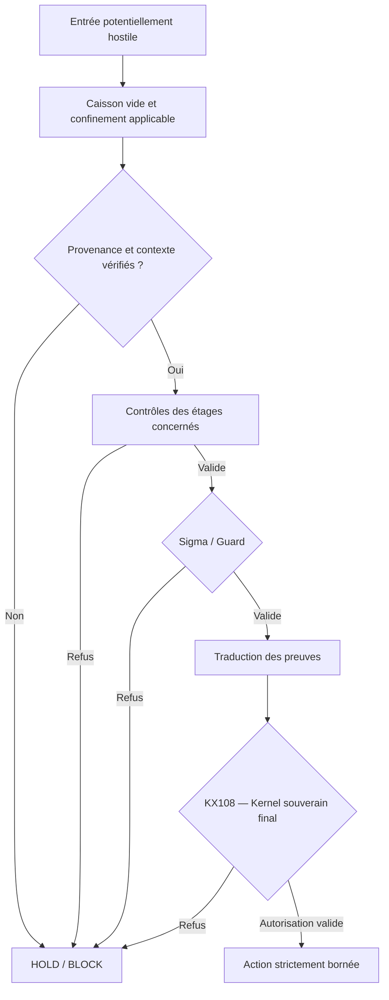
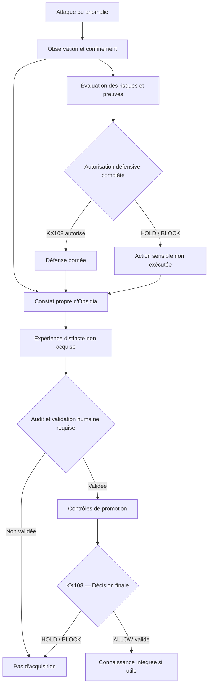

# **OBSIDIA — DOCTRINE DE CYBERSÉCURITÉ STRUCTURELLE ET DE DÉFENSE EXPÉRIENTIELLE**

**Version V3 — Validée sur le fond par Étienne (28 novembre 2026) ; implémentation et preuves techniques distinctes.**

## **1. La philosophie de départ : rendre l'attaque inutile**

La cybersécurité classique cherche principalement à empêcher les attaques de réussir : protéger les réseaux, vérifier les identités, chiffrer les communications, détecter les logiciels malveillants, limiter les accès.

Ces protections sont nécessaires.

Mais la vision d'Obsidia va plus loin.

Le principe n'est pas seulement d'empêcher un attaquant d'entrer. Il est de concevoir un système dans lequel, **même lorsqu'une première protection est franchie, l'attaquant ne doit pas pouvoir obtenir le résultat interdit qu'il recherche.**

Une attaque peut commencer.

Elle peut atteindre une interface.

Elle peut perturber un composant.

Elle peut même révéler une faiblesse locale.

Mais cette faiblesse ne doit pas suffire à donner accès aux données protégées, à modifier les règles, à prendre le contrôle des agents ou à imposer une décision au kernel.

L'objectif n'est donc pas de prétendre qu'aucune vulnérabilité informatique ne pourra jamais exister.

L'objectif est d'empêcher qu'une vulnérabilité locale produise une conséquence interdite.

C'est exactement ce que nous avions retrouvé dans ton [échange Gmail du 3 novembre à 18 h 18](https://mail.google.com/mail/u/0/?utm_source=chatgpt.com#all/1a1a26bdbc7b37ca).

**L'attaque peut exister. Son objectif doit rester inaccessible.**

## **2. Le risque le plus difficile : l'humain et son identité**

C'est le morceau que j'avais oublié.

Dans ton [échange Gmail du 2 octobre à 4 h 25](https://mail.google.com/mail/u/0/?utm_source=chatgpt.com#all/1a0fa6e69b86dfe7), tu avais déjà abordé une situation beaucoup plus difficile à protéger qu'une simple intrusion technique.

Imaginons un attaquant qui parvient à :

- Voler des identifiants.
- Récupérer une session authentifiée.
- Compromettre le téléphone ou l'ordinateur d'une personne.
- Se faire passer pour un utilisateur légitime.
- Utiliser les permissions d'un administrateur.
- Manipuler psychologiquement une personne autorisée.
- Faire exécuter une opération par le véritable propriétaire du compte.

Dans ces situations, un système peut reconnaître une identité valide alors que l'action demandée reste dangereuse ou interdite.

C'est la distinction fondamentale :

**Identité authentifiée ≠ action autorisée.**

Et même :

**Véritable humain identifié ≠ confiance absolue.**

Prenons un exemple.

Une personne possède réellement le droit de consulter certaines données de son entreprise.

Son compte est authentifié.

Son mot de passe est correct.

Elle utilise éventuellement un appareil connu.

Pourtant, une demande inhabituelle de transfert massif de données peut sortir du cadre autorisé.

Obsidia ne doit pas considérer cette action comme légitime uniquement parce que le demandeur est bien la personne attendue.

Elle doit vérifier l'ensemble des conditions applicables à l'opération.

L'identité permet de savoir **qui demande**.

Elle ne suffit pas à démontrer **que ce qui est demandé doit être autorisé**.

### **L'humain peut lui-même devenir le vecteur de l'attaque**

Un attaquant n'a pas nécessairement besoin d'usurper l'identité du responsable.

Il peut chercher à le convaincre d'effectuer lui-même l'action.

L'humain est alors authentique.

L'outil peut être légitime.

Mais la demande ou ses conséquences peuvent être incompatibles avec les politiques de protection.

C'est pourquoi la sécurité d'Obsidia ne peut pas reposer uniquement sur la bonne volonté, l'identité ou la position hiérarchique d'une personne.

Même toi, Étienne, tu as voulu un système capable de te répondre NON si une opération ne respecte pas ses lois.

Ce n'est pas une limitation accidentelle de ton autorité.

**C'est une protection que tu as volontairement inscrite dans ton architecture.**

## **3. GPS, contexte physique et cohérence de l'identité**

Dans tes anciens travaux, tu as développé une approche qui ne s'arrête pas à l'identifiant numérique.

Le GPS et les informations provenant du monde physique peuvent contribuer à vérifier la cohérence d'une situation.

Mais il faut préserver la distinction que tu as déjà établie :

**Signal GPS ≠ position certaine ≠ identité prouvée ≠ autorisation.**

Dans tes documents, tu distingues notamment le signal physique, sa provenance, son interprétation et l'état supposé du monde.

Appliqué à la cybersécurité, cela signifie qu'une position GPS peut constituer un indice, mais jamais une autorité souveraine.

### **Exemple : une connexion inhabituelle**

Un utilisateur demande l'exécution d'une opération sensible.

Obsidia peut disposer, selon les autorisations et les capteurs réellement disponibles, de plusieurs informations :

| Élément        | Question de sécurité                                                      |
| -------------- | ------------------------------------------------------------------------- |
| Identité       | Qui est authentifié ?                                                     |
| Session        | Comment la session a-t-elle été établie ?                                 |
| Appareil       | Quel équipement présente la demande ?                                     |
| GPS            | Quelle position est déclarée ou mesurée ?                                 |
| Provenance GPS | D'où vient le signal et peut-il être vérifié ?                            |
| Temporalité    | Les horaires sont-ils cohérents ?                                         |
| Contexte       | L'opération correspond-elle à la situation autorisée ?                    |
| Historique     | Existe-t-il une contradiction pertinente avec les événements précédents ? |
| Autorité       | Cette opération précise est-elle permise ?                                |
| Preuves        | Les conditions exigées sont-elles démontrées ?                            |

Si plusieurs éléments se contredisent, Obsidia ne doit pas inventer une explication favorable.

Elle doit conserver l'incertitude et appliquer les contrôles requis.

### **Attention à la falsification GPS**

Un GPS peut être perturbé ou falsifié.

Une localisation provenant d'un téléphone compromis n'est pas automatiquement fiable.

L'adresse IP n'est pas non plus une preuve certaine de localisation physique.

C'est pourquoi l'idée n'est pas de dire :

« Le GPS correspond, donc la personne est autorisée. »

Mais plutôt :

« Le contexte physique présente-t-il les garanties exigées pour cette opération ? »

Et lorsque les garanties nécessaires ne sont pas démontrées, l'action sensible ne doit pas progresser.

**Le GPS contribue à la vérification. Il ne donne pas le droit d'agir.**

Cela respecte également ta doctrine des couches : chaque composant fournit les informations qu'il peut légitimement établir, sans prétendre connaître ce qui relève d'un autre étage.

## **4. Le véritable danger : modifier ce que le système considère comme légitime**

C'est un autre point important retrouvé dans le mail du 2 octobre.

Un attaquant expérimenté peut éviter d'attaquer directement le kernel.

Il peut essayer de modifier progressivement les informations ou les règles que les autres couches présentent comme légitimes.

Par exemple :

1. Il introduit des informations trompeuses dans un composant accessible.
2. Il tente de faire considérer ces informations comme fiables.
3. Il provoque des propositions de modification.
4. Il cherche à faire accepter progressivement de nouvelles règles.
5. Il espère qu'une action autrefois interdite sera finalement présentée comme normale.

C'est une attaque contre les conditions de légitimité.

Elle est particulièrement importante parce qu'un système peut conserver des signatures correctes, des empreintes intègres et des journaux cohérents tout en ayant accepté, auparavant, une mauvaise règle.

La cryptographie démontre certaines propriétés d'intégrité et d'authenticité.

Elle ne démontre pas à elle seule qu'une politique est juste ou admissible.

La défense doit donc aussi porter sur la manière dont les règles, les interprétations et les connaissances sont acceptées.

**Une donnée extérieure ne doit pas pouvoir changer progressivement les critères qui permettront ensuite de l'autoriser.**

## **5. Obsidia ne doit pas polluer sa propre mémoire**

C'est le principe que tu viens de réaffirmer.

Lorsqu'Obsidia subit une attaque, elle ne doit pas intégrer les fichiers, instructions ou affirmations de l'attaquant dans sa mémoire native comme s'il s'agissait de connaissances.

Elle observe les événements.

Elle en tire son propre constat.

Elle distingue les éléments démontrés, les hypothèses et les incertitudes.

Elle peut identifier les protections sollicitées et les améliorations potentiellement utiles.

Mais **ce constat n'est pas automatiquement une connaissance acquise**.

L'expérience reste séparée.

Obsidia ne doit pas apprendre à faire confiance au contenu de l'attaque sous prétexte qu'elle l'a analysé.

### **Les statuts doivent rester distincts**

| Statut                | Signification                                                                 |
| --------------------- | ----------------------------------------------------------------------------- |
| Donnée reçue          | Une information a été rencontrée.                                             |
| Observation           | Un événement a été constaté.                                                  |
| Hypothèse             | Une interprétation est envisagée.                                             |
| Expérience            | Obsidia dispose d'un constat sur ce qui s'est produit.                        |
| Apprentissage proposé | Une amélioration possible a été identifiée.                                   |
| Connaissance validée  | Le parcours de validation exigé est terminé.                                  |
| Action autorisée      | L'opération dispose de l'autorisation applicable, avec KX108 souverain final. |

Aucun de ces statuts ne se transforme automatiquement dans le suivant.

C'est cohérent avec ton [checkpoint doctrinal du 2 octobre](https://mail.google.com/mail/u/0/?utm_source=chatgpt.com#all/1a0fe15e1b190ae8), qui distinguait déjà données, observations, expériences, apprentissage, connaissances et mémoire.

## **6. Une défense peut utiliser une expérience sans l'acquérir**

Tu as apporté une précision essentielle.

À l'instant T, les informations observées pendant une attaque peuvent être utiles.

Obsidia peut s'en servir pour déterminer quelle protection déjà autorisée appliquer.

Mais cette utilisation reste opportuniste.

Cela ne signifie pas qu'elle croit définitivement l'information.

Cela ne signifie pas qu'elle peut enregistrer une nouvelle vérité.

Cela ne signifie pas qu'elle peut inventer une nouvelle protection et l'activer librement.

Et surtout :

**Même une réponse défensive doit respecter l'ensemble de la chaîne d'autorisation.**

Si la protection envisagée exige des preuves qui ne sont pas présentes, l'opération ne doit pas être exécutée.

Si une action sort du cadre de Sigma, de Guard ou de KX108, l'urgence ne constitue pas une dérogation.

La défense n'est pas au-dessus des lois d'Obsidia.

## **7. Le Caisson vide et les frontières successives**

Les informations potentiellement hostiles doivent traverser les frontières de traitement qui leur sont applicables.

Tu as explicitement rappelé le **Caisson vide**.

Il doit donc apparaître dans la doctrine de traitement des événements hostiles.

Je conserve ici son nom et son rôle de frontière à examiner, mais sans inventer les détails de son implémentation que je n'ai pas retrouvés dans les messages Gmail consultés.

Le principe de fonctionnement est le suivant :

Le schéma illustre les responsabilités, sans prétendre fixer l'ordre exact de toutes les fonctions du runtime.

Chaque étage doit montrer patte blanche au suivant.

Un contrôle obligatoire en échec bloque l'action concernée.

Aucun étage ne peut déclarer que le contrôle suivant est inutile.

## **8. KX108 : l'autorité finale de la sécurité**

Sur ce point, aucune ambiguïté.

**KX108 est le kernel souverain d'Obsidia.**

Il ne comprend pas directement le monde.

Il ne comprend pas directement les intentions humaines, les coordonnées GPS, les attaques ou les raisonnements linguistiques.

Les couches compétentes doivent traduire et établir les éléments nécessaires dans son langage contractuel.

KX108 vérifie les conditions formelles qui lui sont présentées.

Il ne doit pas être influencé par un récit émotionnel, une pression humaine ou une demande exceptionnelle.

La sécurité d'Obsidia ne peut donc pas être suspendue parce qu'un utilisateur affirme être en danger, parce qu'un administrateur donne un ordre, ou parce qu'un agent estime qu'une opération serait bénéfique.

Les faits pertinents doivent être établis.

Les preuves doivent être recevables.

Les contrats doivent être respectés.

**Et KX108 valide en dernier. Toujours.**

L'identité d'Étienne ne crée pas de bypass.

L'intransigeance de KX108 fait partie de la vision fondatrice d'Obsidia.

## **9. Le cycle de traitement d'une attaque**

Voici le fonctionnement visé, en séparant les opérations immédiates du traitement de l'expérience.

Le premier parcours répond à la question : « Que peut faire Obsidia maintenant ? »

Le second répond à la question : « Que peut-elle conserver et considérer comme acquis après l'incident ? »

Ce sont deux autorisations différentes.

La réussite du premier ne valide pas automatiquement le second.

## **10. La cybersécurité structurelle et la cybersécurité conventionnelle se complètent**

Tu n'as pas demandé de remplacer les protections informatiques classiques.

La structure d'Obsidia doit fonctionner avec elles.

La sécurité conventionnelle cherche notamment à protéger l'ordinateur, le réseau, les secrets, les comptes, les communications et les fichiers.

La sécurité structurelle d'Obsidia cherche à empêcher qu'un accès ou une compromission se transforme en opération interdite.

| Attaque                   | Protection conventionnelle          | Protection structurelle visée              |
| ------------------------- | ----------------------------------- | ------------------------------------------ |
| Vol de mot de passe       | MFA, protection des identifiants    | Identité seule insuffisante pour autoriser |
| Session compromise        | Révocation, contrôle de session     | Revalidation de l'opération et du contexte |
| GPS falsifié              | Contrôle des sources et signaux     | Localisation non promue en preuve absolue  |
| Prompt injection          | Isolation et traitement des entrées | Instructions hostiles sans autorité        |
| Agent compromis           | Confinement du processus            | Refus des actions hors contrat             |
| Tentative d'exfiltration  | Contrôles réseau et données         | Lecture et export soumis aux permissions   |
| Pollution de mémoire      | Contrôle des écritures              | Aucune acquisition sans validation         |
| Modification de politique | Contrôle d'intégrité et des accès   | Mutation elle-même soumise à autorisation  |
| Rejeu d'une décision      | Nonces et journaux protégés         | Refus des autorisations déjà consommées    |

Les deux protections doivent être conçues pour ne pas dépendre du même point de défaillance.

## **11. Ce qui doit être démontré pour que cette sécurité soit réelle**

La doctrine formule un objectif architectural.

Elle ne constitue pas, à elle seule, une preuve que le système est inviolable.

Pour en démontrer l'application, les tests devront notamment vérifier :

1. Qu'une session authentifiée ne suffit pas à autoriser une opération sensible.
2. Qu'une identité humaine légitime ne contourne pas les politiques.
3. Qu'une localisation GPS falsifiée ne peut pas accorder une permission.
4. Que les contradictions de contexte pertinentes déclenchent les contrôles prévus.
5. Qu'une injection ne peut pas devenir une instruction souveraine.
6. Qu'un composant compromis ne peut pas accéder librement aux autres étages.
7. Que les accès en lecture et les exportations sont protégés avant toute divulgation.
8. Qu'une observation hostile ne pollue pas la mémoire native.
9. Qu'une expérience non validée ne devient pas une connaissance acquise.
10. Qu'une défense immédiate ne contourne jamais la chaîne d'autorisation.
11. Qu'une modification progressive des règles ne peut pas échapper aux contrôles.
12. Que Sigma, Guard et KX108 conservent leurs rôles existants.
13. Que KX108 demeure le décideur souverain final.
14. Qu'aucun chemin d'exécution alternatif ne permet de contourner ces contrôles.

Les preuves devront distinguer ce qui est déjà implémenté, ce qui a été testé et ce qui reste non démontré.

## **12. La finalité de cette doctrine**

L'objectif de la cybersécurité d'Obsidia n'est pas de reconnaître parfaitement tous les hackers, toutes les attaques ou toutes les manipulations.

Il est de concevoir un système où **la réalisation d'une action interdite exige de franchir des conditions qu'aucune donnée hostile, aucune identité isolée et aucune couche compromise ne peut légitimement supprimer.**

Obsidia peut subir une attaque.

Elle peut l'observer.

Elle peut utiliser cette expérience pour répondre dans son cadre autorisé.

Elle peut produire son propre constat.

Elle peut proposer une amélioration.

Mais elle ne prend rien pour argent comptant.

Elle n'intègre rien comme connaissance acquise sans validation.

Elle ne se donne aucun droit nouveau.

Et aucune défense, aucune identité ni aucune urgence ne peut supprimer la souveraineté finale de KX108.

**La véritable protection n'est pas simplement d'empêcher l'attaque d'entrer. C'est de l'empêcher d'obtenir ce qu'elle est venue chercher.**

## **Sources Gmail retrouvées**

J'ai utilisé ces échanges pour reconstruire le support :

- [2 octobre — Identité humaine, contexte, « montrer patte blanche » et corruption progressive des règles](https://mail.google.com/mail/u/0/?utm_source=chatgpt.com#all/1a0fa6e69b86dfe7)
- [2 octobre — Lois d'architecture, statuts informationnels et GPS](https://mail.google.com/mail/u/0/?utm_source=chatgpt.com#all/1a0fe15e1b190ae8)
- [3 novembre, 18 h 18 — Attaque structurellement incapable de produire un effet interdit](https://mail.google.com/mail/u/0/?utm_source=chatgpt.com#all/1a1a26bdbc7b37ca)
- [3 novembre, 18 h 23 — Autorisation contextuelle, limites de la traçabilité et protection des lectures](https://mail.google.com/mail/u/0/?utm_source=chatgpt.com#all/1a1a26ff7470365b)
- [3 novembre, 18 h 25 — Sécurité structurelle et cybersécurité conventionnelle](https://mail.google.com/mail/u/0/?utm_source=chatgpt.com#all/1a1a271f9983fbbf)
